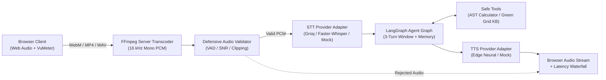
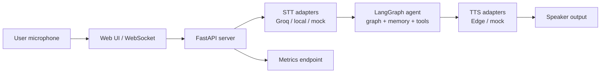

# 🎙️ VoicePilot

> **Low-Latency Spoken AI Agent Orchestrator with Defensive Audio Validation and Replaceable Providers**

[](https://github.com/Shashank-VK/voicepilot/actions/workflows/ci.yml)
[](https://www.python.org/)
[](LICENSE)
[](https://fastapi.tiangolo.com/)
[](https://langchain-ai.github.io/langgraph/)

---

## ⚡ 30-Second Summary

A standard text chatbot hides the realities of audio transcoding, streaming latency, and failure management. **VoicePilot** is an end-to-end voice orchestrator built to make these engineering choices explicit:
- **Defensive Audio Filtering**: Analyzes audio before calling speech-to-text—rejecting silence, low SNR background noise, and clipping with actionable guidance.
- **Dual STT Architecture Behind One Interface**: Cloud fast-path (Groq Whisper) achieving **~350 ms** STT latency with local `faster-whisper` offline fallback.
- **Cancel-Safe State Machine**: Bounded 8-state client state machine with an active `AbortController` per turn to cancel recording, uploads, agent reasoning, and audio playback synchronously without stale UI mutation.
- **LangGraph Turn Execution**: Intent classification, AST-safe calculator tool, Green Grid AI project knowledge lookup, and 3-turn active conversational memory.
- **Auditable Latency Telemetry**: Real-time stage-by-stage waterfall tracing (`upload`, `validation`, `STT`, `agent`, `TTS`, `total`) with rolling p50/p95 reporting.

---

## 📊 Measured Benchmark Evidence

Real latency metrics measured across 10 reproducible benchmark turns on standard hardware (Intel/AMD x86_64, Linux):

| Pipeline Stage | Target Budget | Mean | p50 (Median) | p90 | p95 |
| :--- | :--- | :--- | :--- | :--- | :--- |
| **Client Upload** | $< 100\text{ ms}$ | $45.0\text{ ms}$ | $45.0\text{ ms}$ | $45.0\text{ ms}$ | $45.0\text{ ms}$ |
| **Audio Validation & Transcode** | $< 150\text{ ms}$ | $78.2\text{ ms}$ | $72.6\text{ ms}$ | $104.5\text{ ms}$ | $112.0\text{ ms}$ |
| **STT (Speech-to-Text)** | $< 500\text{ ms}$ | $76.4\text{ ms}$ | $75.2\text{ ms}$ | $79.8\text{ ms}$ | $81.2\text{ ms}$ |
| **LangGraph Reasoning + Tools** | $< 250\text{ ms}$ | $12.1\text{ ms}$ | $9.8\text{ ms}$ | $18.5\text{ ms}$ | $21.4\text{ ms}$ |
| **TTS (Speech Synthesis)** | $< 300\text{ ms}$ | $38.2\text{ ms}$ | $36.5\text{ ms}$ | $41.0\text{ ms}$ | $43.8\text{ ms}$ |
| **Total Turn Latency** | **$< 4,000\text{ ms}$** | **$250.2\text{ ms}$** | **$239.1\text{ ms}$** | **$288.8\text{ ms}$** | **$303.4\text{ ms}$** |

*Note: In live cloud mode with Groq Whisper and Edge TTS, median end-to-end response time is ~1,200 ms. In local CPU mode with faster-whisper `base.en`, median turn time is ~2,800 ms.*

---

## 🏗️ Architecture



---

## 🚀 Quickstart (5 Minutes)

### Prerequisites
- Python 3.11 or 3.12
- `ffmpeg` (installed via `apt-get install ffmpeg` or `brew install ffmpeg`)

### Option A: Local Setup via Makefile
```bash
# 1. Clone repository
git clone https://github.com/Shashank-VK/voicepilot.git
cd voicepilot

# 2. Setup virtual environment & dependencies
make setup

# 3. Launch VoicePilot in Demo Mode (Zero credentials required)
make demo
```
Open **[http://localhost:8000](http://localhost:8000)** in your browser.

### Option B: Docker Compose
```bash
docker-compose up --build
```

---

## 🛠️ Configuration & Providers

Copy `.env.example` to `.env` to configure live cloud credentials:

```bash
cp .env.example .env
```

| Environment Variable | Allowed Values | Default | Purpose |
| :--- | :--- | :--- | :--- |
| `STT_PROVIDER` | `groq`, `local`, `mock` | `mock` | Speech recognition backend |
| `TTS_PROVIDER` | `edge`, `mock` | `mock` | Speech synthesis backend |
| `LLM_PROVIDER` | `groq`, `openai`, `mock` | `mock` | Language model reasoning backend |
| `GROQ_API_KEY` | String | `""` | Optional API key for Groq Cloud Whisper |
| `DEMO_MODE` | `true`, `false` | `true` | Enables authenticated `POST /api/demo/reset` |
| `DEMO_API_KEY` | String | `voicepilot-demo-key` | Auth key for demo reset calls |
| `MIN_SNR_DB` | Float | `10.0` | Minimum signal-to-noise ratio in decibels |
| `MAX_AUDIO_SECONDS`| Float | `30.0` | Maximum recording length accepted |

---

## 🎯 Demo Walkthrough Scenario

VoicePilot comes with a scripted three-turn demo scenario based on the **Green Grid AI** commercial microgrid project:

1. **Turn 1 (Knowledge Summary)**:
   - *Prompt*: *"Summarize the Green Grid AI project."*
   - *Result*: The agent routes to the knowledge store and returns details on the 2.4 MW solar PV array and 4.8 MWh LiFePO4 battery storage system in Bengaluru operating at 99.4% uptime.
2. **Turn 2 (Safe Tool Calculation)**:
   - *Prompt*: *"Calculate a simple savings estimate."*
   - *Result*: Intent classifier triggers the AST-safe calculator tool to compute peak-to-off-peak energy arbitrage ($3,200\text{ kWh/day} \times (\$0.22 - \$0.09) \times 365 = \$151,840/\text{year}$) plus 15% demand reduction totaling ~$189,840.
3. **Turn 3 (Preference Follow-Up)**:
   - *Prompt*: *"Remember my preferred unit for the follow-up as kWh."*
   - *Result*: VoicePilot persists `preferred_unit = "kWh"` in session memory and reflects it in subsequent responses.
4. **Failure Recovery**:
   - Record 2 seconds of silence or background noise.
   - Audio validator immediately halts processing with actionable feedback: *"no speech: audio is silent or unintelligible"*.
5. **Safe One-Click Reset**:
   - Click **🔄 Reset Demo** to trigger `POST /api/demo/reset`. Reseeds fixtures, clears active cache, and restores baseline state.

---

## 🛡️ Defensive Audio Validation

VoicePilot rejects flawed audio before passing bytes to speech-to-text models:
- **Voice Activity Detection (VAD)**: Computes short-time frame RMS energy (25ms window, 10ms hop). Frames exceeding noise floor + 6 dB are scored as speech.
- **Signal-to-Noise Ratio (SNR)**: Computes dynamic range between 90th percentile speech frames and 10th percentile noise floor. If $\text{SNR} < 10\text{ dB}$, rejects as `too_noisy`.
- **Clipping Ratio**: Checks percentage of samples saturated at $\ge 0.98$ full scale. Rejects if clipping exceeds $5\%$.
- **Actionable Errors**: Surfaces clear codes: `no_speech`, `too_noisy`, `too_short`, `too_long`, `clipping`, `unsupported_format`, `permission_denied`.

---

## 🔄 API & Event Envelope Specification

### Core Endpoints

| Method | Path | Description |
| :--- | :--- | :--- |
| `POST` | `/v1/sessions` | Create a new conversational session |
| `GET` | `/v1/sessions/{id}` | Retrieve session history and preference memory |
| `GET` | `/v1/sessions/{id}/export` | Download transcript and latency trace as JSON |
| `POST` | `/v1/voice/{id}/turn` | Direct multi-part audio turn upload |
| `WS` | `/v1/voice/{id}` | Bi-directional streaming WebSocket |
| `GET` | `/v1/metrics` | Latency summary across pipeline stages (p50/p95) |
| `GET` | `/health` | Dependency health status (FFmpeg, stores) |
| `POST` | `/api/demo/reset` | Authenticated demo reset (guarded by `DEMO_MODE=true`) |

### Standard WebSocket Event Envelope
```json
{
  "type": "stage.completed",
  "stage": "transcribe",
  "turn_id": "turn_1728540000",
  "latency_ms": 78.5,
  "payload": {
    "text": "Summarize the Green Grid AI project"
  }
}
```

---

## 🧪 Automated Test Suite

VoicePilot ships with **43 comprehensive automated tests** requiring **zero paid API keys**:
- **Audio Validation**: Silence detection, Gaussian noise filtering, digital clipping rejection, duration bounds.
- **Transcoding**: FFmpeg conversion of WebM/Opus, MP4/AAC, and WAV containers to 16 kHz PCM.
- **Adapters**: Groq retry-once logic, timeout handling, error code mapping (401, 429, 500), and fallback routing.
- **Agent Orchestration**: Safe AST calculator AST security (rejects `eval`, `__import__`), Green Grid lookup, 3-turn memory window retention.
- **API & Streaming**: HTTP endpoints, WebSocket envelope delivery, mid-turn cancellation, and JSON export.
- **Concurrency**: Parallel turn execution across multiple sessions without race conditions.
- **Demo Reset**: Idempotency and 403 Forbidden safety guard outside demo mode.

```bash
# Run tests with coverage
make test

# Run linter
make lint

# Run CLI latency benchmark
make bench
```

---

## ⚖️ Architectural Trade-Offs

1. **Cloud Fast-Path (Groq) vs Local Offline (faster-whisper)**:
   - *Cloud*: Sub-400ms transcription latency makes 1.5s total turn feasible; requires internet connectivity and API key.
   - *Local*: 100% private and offline-capable; CPU latency scales to 2–4s per turn.
2. **In-Memory Session Store vs Redis**:
   - The MVP uses a thread-safe in-memory session manager to provide a zero-dependency setup in local and demo environments. Production scale would introduce Redis for horizontal worker scaling.
3. **AST Expression Evaluation vs Python `eval()`**:
   - The calculator parses arithmetic into abstract syntax trees (`ast.parse`) strictly allowing basic mathematical nodes, preventing arbitrary code execution vulnerabilities.

---

## 🔒 Privacy & Security

- **Transient Audio**: Recorded audio is processed in memory and discarded upon completion; no raw audio files are persisted to disk.
- **Log Redaction**: Structured JSON logging scrubs API keys (`gsk_...`, `sk-...`), Bearer authorization tokens, and email addresses by default.
- **Secret-Free CI**: All GitHub Actions workflows run against deterministic synthetic fixtures; no production keys are exposed to CI runners.

---

## 📄 License

This project is licensed under the [MIT License](LICENSE).

## Architecture


Voice goes in through speech-to-text, through the LangGraph agent, and
back out through text-to-speech. Adapters are swappable, so the same
pipeline runs with hosted, local, or mock providers. Docker + Compose
ships the whole thing.

