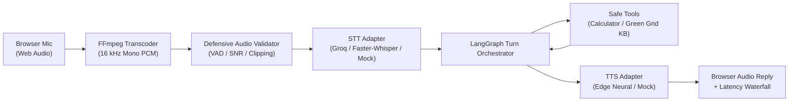
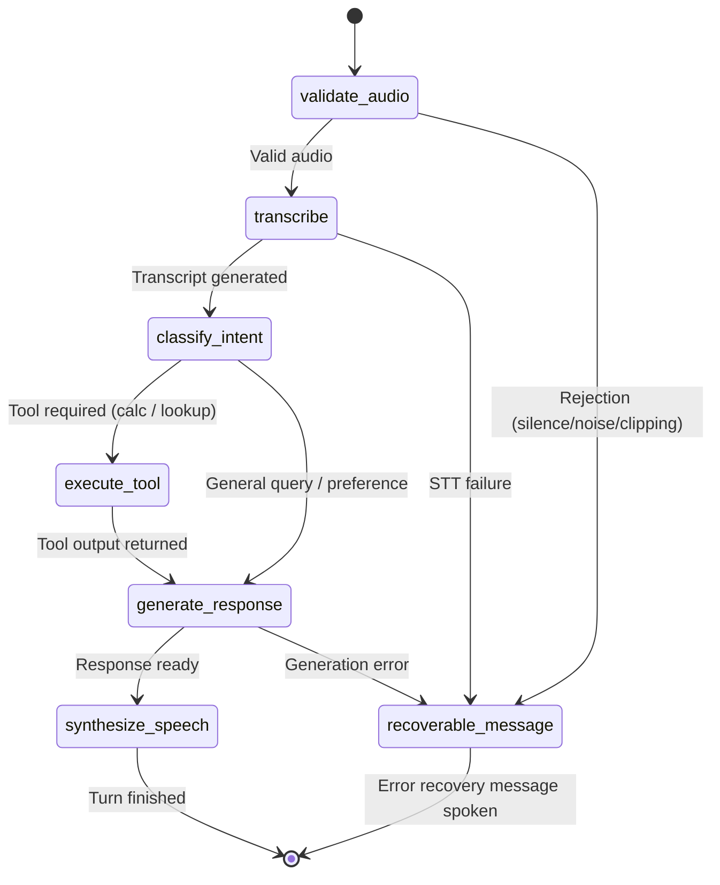

# VoicePilot: Architecture & Engineering Blueprint

VoicePilot is a voice-first AI agent orchestrator engineered for low-latency turn management, defensive audio validation, and replaceable speech-to-text / text-to-speech providers.

---

## 1. End-to-End Request Path



---

## 2. LangGraph State Machine

Every user turn executes through an explicit state graph:



---

## 3. Client State Machine & Cancellation

The frontend implements an 8-state explicit state machine:

```
[idle] ──> [recording] ──> [uploading] ──> [transcribing] ──> [reasoning] ──> [speaking] ──> [idle]
   │           │                 │                 │                │               │
   └───────────┴─────────────────┴─────────────────┴────────────────┴───────────────┴──> [cancelled]
                                                                                        │
                                        Any Validation / Provider Error ───────────────> [error]
```

### AbortController Semantics
- Each turn generates a unique `turn_id` and a scoped `AbortController`.
- Clicking **Cancel Turn** triggers:
  1. Instant `abort()` signal sent to in-flight HTTP uploads.
  2. Immediate stopping of browser `MediaRecorder` and `AudioContext`.
  3. `turn.cancel` WebSocket envelope emitted to the server.
  4. Immediate halt of HTML5 audio playback.
  5. Any late-arriving messages or synthesized audio chunks matching that `turn_id` are permanently dropped.

---

## 4. Defensive Audio Validation Contract

To prevent wasting costly LLM/STT invocations on corrupted or empty audio, VoicePilot verifies audio on 16kHz mono PCM before sending to transcription:

| Condition | Mathematical Check | Actionable Error Returned |
| :--- | :--- | :--- |
| **Silent Audio** | Peak amplitude $< 0.015$ ($-36\text{ dBFS}$) | `no_speech: audio is silent or unintelligible` |
| **Noisy Background** | $\text{SNR} = E_{\text{speech}, 90\%} - E_{\text{noise}, 10\%} < 10\text{ dB}$ | `too_noisy: signal-to-noise ratio is too low` |
| **Severe Clipping** | Fraction of samples with $|x| \ge 0.98$ exceeds $5\%$ | `clipping: audio input is severely clipped or distorted` |
| **Too Short** | Active speech duration $< 0.5\text{ s}$ or total $< 0.2\text{ s}$ | `too_short: audio must contain at least 0.5s of speech` |
| **Oversized** | Total duration $> 30.0\text{ s}$ | `too_long: audio exceeds maximum allowed duration` |
| **Unsupported Codec** | FFmpeg decoding error | `unsupported_format: please provide valid audio` |

---

## 5. Latency Waterfall & Percentiles

Turn latency is measured and reported across five distinct stages:
1. **Upload (`upload`)**: Network transit from browser to server.
2. **Audio Validation (`validate_audio`)**: FFmpeg transcoding to 16 kHz PCM + short-time frame RMS energy analysis.
3. **STT (`stt`)**: Speech-to-text transcription (Groq Whisper cloud vs faster-whisper local).
4. **Agent Reasoning & Tools (`agent`)**: Intent classification, safe AST calculator, Green Grid AI knowledge lookup, prompt assembly.
5. **TTS Synthesis (`tts`)**: Neural speech synthesis (Edge TTS or local mock).

### Cloud vs Local Trade-Offs

| Provider Mode | STT Latency (p50) | TTS Latency (p50) | Total Turn Time (p50) | Internet Required | Hardware Requirement |
| :--- | :--- | :--- | :--- | :--- | :--- |
| **Cloud Fast-Path (Groq + Edge TTS)** | ~350 ms | ~450 ms | **~1,200 ms** | Yes | Any laptop / CPU |
| **Local Offline (faster-whisper CPU)** | ~1,800 ms - 3,500 ms | ~400 ms | **~2,800 ms - 4,500 ms** | No | 4-core CPU / 4GB RAM |
| **Mock / CI Fixtures** | ~75 ms | ~35 ms | **~190 ms** | No | Any CI runner |

---

## 6. Privacy & Structured Logging

- **Transient Audio Processing**: Audio is processed entirely in-memory and discarded upon turn completion; never saved to disk.
- **Log Redaction**: Structured JSON logs automatically scrub credentials, Authorization headers, Bearer tokens, and email addresses.
- **Deterministic Reset**: `POST /api/demo/reset` safely restores demo fixtures and resets session caches without leaving dangling artifacts.
